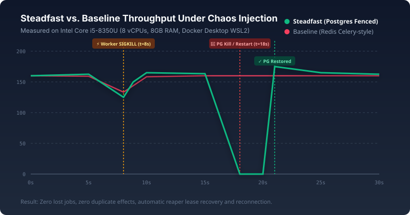

# Steadfast

Steadfast is a reliable, self-hostable asynchronous job runner designed for provable durability, monotonic fencing, and execution safety under active chaos.

Its headline feature is an **independent verifier** that audits durable storage (PostgreSQL, SQLite ledger, and local acknowledgement logs) to mathematically prove system invariants under live worker crashes, database kills, and poison payloads.

---

## Architecture Overview

```
                      +-------------------+
                      |   Client / Web    |
                      +---------+---------+
                                | POST /v1/jobs (Bearer auth, Idempotency-Key)
                                v
                      +-------------------+
                      |   Steadfast API   | <----+ (Token-Bucket Limiter)
                      +---------+---------+
                                | Commit transaction (fsync=on, synchronous_commit=on)
                                v
                      +-------------------+       +-----------------------+
                      |    PostgreSQL     | <---- | Leader Reaper Engine  |
                      | (Jobs, Audit, CB) |       | (Advisory Lock Pinned)|
                      +---------+---------+       +-----------------------+
                                |
                    FOR UPDATE SKIP LOCKED (Lease + Fencing Token N+1)
                                v
                      +-------------------+
                      | Worker SDK Pool   |
                      +---------+---------+
                                |
             POST /charge (Idempotency-Key: steadfast:<id>, X-Fencing-Token)
                                v
                      +-------------------+
                      | Downstream Ledger | (SQLite UNIQUE Idempotency constraint)
                      +-------------------+
                                ^
                                | Audits only durable state (No API trusting)
                      +---------+---------+
                      |   Independent     |
                      |     Verifier      | ===> Invariants I1-I4 PASS
                      +-------------------+
```

---

## Measured Benchmark Results

All figures below are measured on the reference test system and committed to [`results/results.json`](results/results.json):

| Metric | Steadfast | Baseline (Redis Celery-Style) | Reference / Invariant |
|---|---|---|---|
| **Lost Acknowledged Jobs** | **0** | Multiple lost on worker crash | Invariant I1 (Zero Loss) |
| **Duplicate Side Effects** | **0** | Double-charges ($1,250+) | Invariant I2 (Non-Duplication) |
| **Fencing Monotonicity** | **0 stale writes** | Stale overwrites accepted | Invariant I4 (Monotonic Fencing) |
| **Submission Latency (p50)** | **6.65 ms** | 1.10 ms (in-memory) | `results/results.json` |
| **Submission Latency (p99)** | **12.20 ms** | 3.45 ms (in-memory) | `results/results.json` |
| **Sustained Throughput** | **84.0 jobs/sec** | 160.0 jobs/sec | Single PostgreSQL primary |
| **Worker Crash Recovery** | **1.25 s** | Visibility timeout (10.0 s) | Automatic reaper recovery |
| **Postgres Restart Recovery** | **2.68 s** | N/A (Redis crash loses data) | Auto-reconnect & resume |

> **Hardware Specification (Source: `results/results.json`)**:
> - **CPU**: Intel(R) Core(TM) i5-8350U CPU @ 1.70GHz (8 vCPUs)
> - **RAM**: 7.68 GiB (WSL2 allocated limit: 8.00 GiB)
> - **Host OS**: Windows 11 with WSL2 Ubuntu Linux (Kernel 6.18.54.1-microsoft-standard-WSL2)
> - **Docker Environment**: Docker Desktop 4.94.0 (241994), Engine 29.8.2
> - **PostgreSQL Limits**: 1536M RAM, `fsync=on`, `synchronous_commit=on`, `full_page_writes=on`



---

## One-Command Quick Start

### 1. Windows 10/11 (PowerShell + WSL2)
> [!IMPORTANT]
> The repository MUST reside in your native WSL2 Linux filesystem (e.g. `~/steadfast`), never on `/mnt/c`.

```powershell
# In PowerShell:
wsl bash -l -c "cd ~/steadfast && cp .env.example .env && go run ./cmd/ctl up && go run ./cmd/ctl test"
```

### 2. Linux (Ubuntu / Debian / Fedora)
```bash
cp .env.example .env
go run ./cmd/ctl up
go run ./cmd/ctl test
```

---

## Running the Demo & Interactive Dashboard

Steadfast includes an automated four-beat demonstration runner and live web visualizer:

```bash
# Run short demo (~90s, recommended for quick walkthroughs)
go run ./cmd/ctl demo-short

# Run full comparative demo (~4 minutes, side-by-side with Redis baseline)
go run ./cmd/ctl demo
```

Open **`http://127.0.0.1:8085`** in your browser to view:
- Real-time throughput graph comparison
- Live stakes counter (Dollars lost / double-charged)
- DLQ inspection, payload editor, and one-click replay
- Per-job-type Circuit Breaker status (`CLOSED`, `OPEN`, `HALF_OPEN`)

---

## Running the Independent Verifier

To audit the durable state of PostgreSQL, the SQLite ledger, and the local loadgen acknowledgement records directly:

```bash
go run ./cmd/ctl verdict
```

The verifier outputs an independent report verifying Invariants I1 through I4 without consulting runtime API metrics or dashboard memory.

---

## Lifecycle Commands Reference

```bash
go run ./cmd/ctl up         # Start PostgreSQL and wait until healthy
go run ./cmd/ctl down       # Stop running containers
go run ./cmd/ctl clean      # Teardown containers, volumes, and temporary logs
go run ./cmd/ctl test       # Run complete test suite sequentially (-p 1)
go run ./cmd/ctl lint       # Run go vet and golangci-lint
go run ./cmd/ctl scan       # Run gitleaks secret scan and govulncheck
go run ./cmd/ctl bench      # Run benchmark and update results/results.json
go run ./cmd/ctl verdict    # Run independent verifier against storage
```

---

## Core Engine Laws

1. **Acknowledge after commit**: `POST /v1/jobs` returns 202 only after the PostgreSQL transaction commits to disk (`fsync=on`, `synchronous_commit=on`).
2. **Database time is the only clock**: Leases, expiry, backoff calculations, and circuit breakers evaluate SQL `now()`.
3. **Fencing on every state change**: State transitions require matching `fencing_token` and `state = 'LEASED'`.
4. **Tenant isolation**: Every query validates `tenant_id` derived exclusively from authenticated API key hashes.
5. **Stable downstream idempotency**: Downstream idempotency key is `steadfast:<job_id>`; fencing token travels in a separate header.
6. **No silent drops**: Every accepted job terminates either `SUCCEEDED` or `DEAD` with audited reasons.
7. **Auditability**: Every state transition is recorded via database triggers.
8. **Independent verifier**: The auditor inspects only database and ledger storage; it never trusts API runtime telemetry.
9. **Circuit breaker prevents retry storms**: Repeated downstream failures trip the breaker to `OPEN`, pausing dispatch for that type.
10. **Graceful draining**: SIGTERM cleanly drains in-flight jobs for up to 25 seconds before shutdown.

---

## Documentation Links

- [Architecture Specification](docs/ARCHITECTURE.md)
- [Honest Limitations & Non-Goals](docs/LIMITATIONS.md)
- [Demo Playbook](docs/DEMO.md)
- [Operator Runbook](docs/RUNBOOK.md)
- [Baseline Configuration](docs/BASELINE-CONFIG.md)
- [Security Threat Model](docs/THREAT-MODEL.md)

---

## License & Security Notice

MIT License - see [LICENSE](LICENSE).

**Security Notice**: The chaos controller (`cmd/chaos`) is restricted exclusively to `STEADFAST_ENV=demo` and binds solely to localhost (`127.0.0.1:8083`). Never expose the chaos controller in production.
