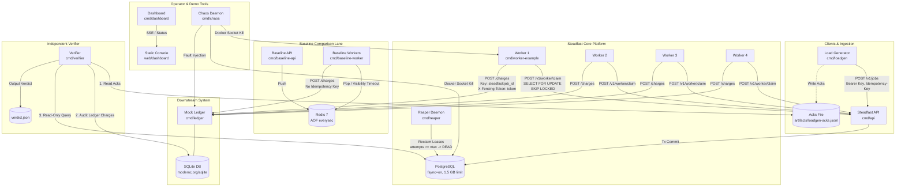
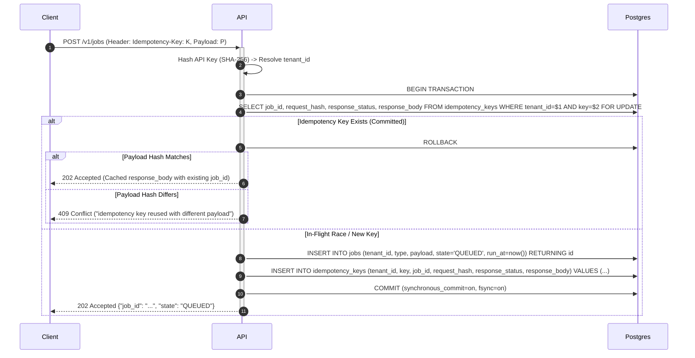
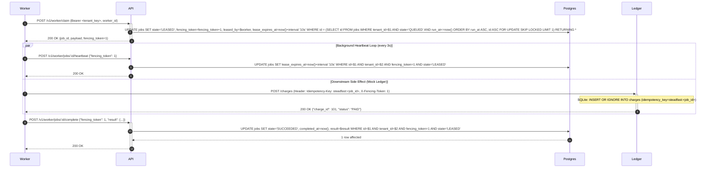
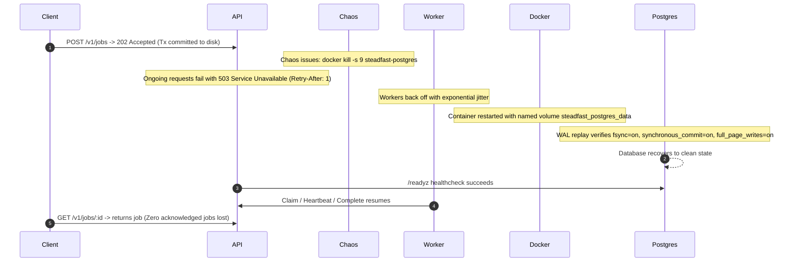
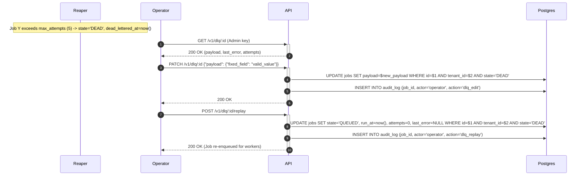

# Steadfast: System Architecture & Technical Specification

Status: Approved Architecture Plan (Prompt 02)

---

## 1. Executive Summary & Design Principles

Steadfast is a reliable, self-hostable asynchronous job runner whose primary design objective is **defensible, provable reliability under chaos**. 

### The Engine Laws
1. **Acknowledge after commit**: `POST /v1/jobs` returns 202 only after the database transaction commits to disk (`fsync=on`, `synchronous_commit=on`).
2. **Database time is the only clock**: Leases, expiry, `run_at`, and backoff calculations use PostgreSQL `now()`.
3. **Fencing on every state change**: State transitions from workers require `state = 'LEASED'` and matching monotonic `fencing_token`.
4. **Tenant isolation at data layer**: Every query requires `tenant_id` derived exclusively from authenticated API key hash.
5. **Stable downstream idempotency**: Downstream idempotency key is `steadfast:<job_id>`; fencing token travels in a separate header.
6. **No silent drops**: Every accepted job terminates either `SUCCEEDED` or `DEAD` with audited failure reasons.
7. **Every state transition is audited**: Recorded via database triggers; operator actions record the actor.
8. **The verifier never grades itself**: Reads only immutable loadgen ack files, SQLite ledger export, and PostgreSQL read-only replica role.

---

## 2. Component Architecture



---

## 3. Sequence Choreography

### 3.1 Durable & Idempotent Submission (F1, F2)


### 3.2 Lease Claim, Heartbeat, Downstream Effect, and Fencing Completion (F3, F7, F8)


### 3.3 Zombie Worker Rejection (Invariant I3, F3)
```mermaid
sequenceDiagram
    autonumber
    Worker A->>API: Claim -> gets job_id=X, fencing_token=1
    Note over Worker A: Worker A stalls / GC pause / network partition
    Note over Reaper: Reaper detects lease_expires_at < now()
    Reaper->>Postgres: UPDATE jobs SET state='QUEUED', run_at=now(), attempts=attempts+1 WHERE id=X AND state='LEASED'
    Worker B->>API: Claim -> gets job_id=X, fencing_token=2
    Worker B->>Ledger: POST /charges (Idempotency-Key: steadfast:X, X-Fencing-Token: 2)
    Ledger-->>Worker B: 200 OK (charge committed)
    Worker B->>API: Complete (fencing_token=2) -> 200 OK (job_id=X is SUCCEEDED)
    Note over Worker A: Worker A wakes up and attempts late actions
    Worker A->>+API: POST /v1/worker/jobs/X/complete {"fencing_token": 1}
    API->>Postgres: UPDATE jobs SET state='SUCCEEDED' WHERE id=X AND tenant_id=$tenant AND fencing_token=1 AND state='LEASED'
    Postgres-->>API: 0 rows affected (fencing_token mismatch & state != 'LEASED')
    API-->>-Worker A: 409 Conflict ("stale fencing token or expired lease")
    Note over Worker A: Worker A discards result; no state corrupted
```

### 3.4 Crash Recovery: Hard Kill of PostgreSQL Container (F1, A1.1)


### 3.5 DLQ Inspect, Edit, and Replay (F6)


---

## 4. Exact Fencing vs. Idempotency Guarantees (Guaranteed Non-Duplication via Receiver Idempotency)

Steadfast explicitly rejects universal duplicate prevention across unreliable networks without receiver cooperation. Instead, it provides two distinct, orthogonal guarantees:

1. **Downstream Side-Effect Protection (Idempotency Key)**:
   - Worker transmits `Idempotency-Key: steadfast:<job_id>` to downstream services.
   - Downstream services (such as `cmd/ledger`) enforce SQLite `UNIQUE(idempotency_key)` constraints.
   - If network partitions or worker crashes cause repeated calls, the downstream deduplicates the call and returns the cached result without duplicate execution (e.g., zero duplicate charges).
2. **Steadfast Job State Protection (Fencing Token)**:
   - The database increments `fencing_token` on every lease claim.
   - Updates (`heartbeat`, `complete`, `fail`) enforce:
     ```sql
     WHERE id = $id AND tenant_id = $tenant_id AND fencing_token = $fencing_token AND state = 'LEASED'
     ```
   - This ensures a late, partitioned "zombie" worker cannot overwrite progress made by a subsequent worker.
3. **Downstream Token Handling**:
   - The ledger records `X-Fencing-Token` with the charge for auditing. If an incoming attempt presents a stale token for an existing charge, the unique idempotency key already shields the customer from a second charge, and the ledger audits the stale attempt.

---

## 5. Verifier Audit Logic & Drain Specification

The independent verifier operates under strict boundaries:
- **No Self-Grading**: Does not call Steadfast REST APIs, does not read dashboard memory or SSE feeds.
- **Data Sources**: (1) `artifacts/loadgen-acks.jsonl`, (2) SQLite `charges` table, (3) PostgreSQL read-only replica connection.

### 5.1 Nonterminal Drain Condition
To prevent active in-flight jobs from being incorrectly flagged as lost, verification requires a nonterminal drain:
```sql
SELECT COUNT(*) FROM jobs 
WHERE state IN ('QUEUED', 'LEASED') 
   OR run_at > now();
```
- If `nonterminal_count > 0` after the test harness timeout (default 60s), the verifier exits with:
  `STATUS: INCOMPLETE (DRAIN_TIMEOUT)` and outputs unresolved job IDs and states. It does **not** declare an Invariant I1 failure.
- When `nonterminal_count == 0`, every acknowledged job has reached a terminal state (`SUCCEEDED` or `DEAD`), and invariant verification commences.

### 5.2 Invariants Evaluated

$$\text{I1: Zero Lost Jobs} \iff \text{Acked Jobs} - (\text{Succeeded Jobs} + \text{Dead Jobs}) == 0$$

$$\text{I2: Effectively-Once Downstream} \iff \text{Duplicate Ledger Charges} == 0$$

$$\text{I2b: Set-Based Payment Correlation} \iff \forall \text{job} \in \text{Jobs}(\text{type='charge\_customer'}, \text{state='SUCCEEDED'}), \exists! \, \text{charge} \in \text{Charges}(\text{status='PAID'}) \text{ where charge.idempotency\_key} = \text{'steadfast:'} \parallel \text{job.id}$$

- **Set-Based Correlation Rule**: Rather than comparing aggregate numbers (`COUNT == COUNT`), the verifier performs a symmetric difference join on `(tenant_id, job_id)`. This prevents an extra charge on one job from masking a missing charge on another.
